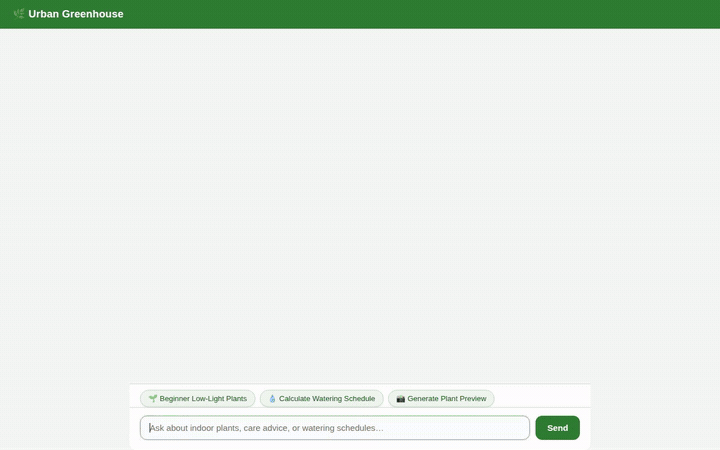

# Urban Greenhouse 🌿

A botanical assistant built with the Google Agent Development Kit (ADK) and Gemini on Google Cloud Vertex AI. Urban Greenhouse helps indoor gardeners manage their houseplant collection, query care details and pricing, log watering schedules, generate visual plant previews, and monitor ambient environment conditions.



---

## What the Agent Does

Urban Greenhouse integrates LLM reasoning with Google Cloud services and specialized domain tools:

- **Greenhouse Plant Catalog (Firestore):**
  - Searches inventory by plant name, species, light requirement, and care difficulty.
  - Retrieves detailed plant profiles including watering cycles, sunlight needs, humidity preferences, and pricing.
  - Supports adding new plants to the greenhouse collection.
  - Logs watering events and retrieves care history per plant.

- **Plant & Interior Previews (Image Generation & Cloud Storage):**
  - Generates photorealistic previews of plants in various interior settings using `gemini-3.1-flash-lite-image`.
  - Automatically saves the generated image as a session artifact (`tool_context.save_artifact`).
  - Uploads the image bytes to a public Google Cloud Storage bucket and returns a direct HTTPS URL for inline viewing.

- **Video Previews (Omni Video Generation & Cloud Storage):**
  - Generates short botanical video clips, animations, and timelapses using Google's Omni model (`gemini-omni-flash-preview`).
  - Stores video artifacts to the session and streams the media to Cloud Storage.

- **Rich Display UI (A2UI v0.8):**
  - Renders structured UI cards (Cards, Columns, Rows, Text, and Images) directly in the chat interface via an `after_model_callback` pipeline.
  - Eliminates raw JSON output in favor of formatted plant catalog listings and visual cards.

- **Cross-Session Memory (Vertex AI Memory Bank):**
  - Uses `PreloadMemoryTool` to retrieve past user facts, plant care preferences, and allergy sensitivities.
  - Implements an `after_agent_callback` (`generate_memories_callback`) that persists extracted facts across sessions.

- **Code Execution Sandbox (Agent Engine Sandbox):**
  - Executes Python in an isolated Vertex AI Agent Engine sandbox to calculate fertilizer dosage, soil drainage ratios, and watering intervals.

- **Ambient Climate & Botanical Weather:**
  - Retrieves real-time temperature and relative humidity metrics for any city via geocoded meteorological APIs to advise on misting and seasonal care adjustments.

- **Nearby Nurseries & Garden Centers:**
  - Geocodes user locations and finds nearby nurseries, florists, and botanical centers using Google Maps and Places REST APIs.

---

## Wired Google Cloud Services

| Service | Component / Purpose | Implementation |
| :--- | :--- | :--- |
| **Vertex AI Agent Engine** | Agent runtime host and secure Python code execution sandbox | `AgentEngineSandboxCodeExecutor` |
| **Vertex AI Memory Bank** | Cross-conversation long-term memory for user preferences & plant care notes | `PreloadMemoryTool` & `generate_memories_callback` |
| **Google Cloud Firestore** | NoSQL document database storing plant catalog (`plants`) and care history (`watering_events`) | `app/firestore_tools.py` |
| **Google Cloud Storage (GCS)** | Public asset storage for generated plant images and video previews | `app/image_tool.py`, `app/video_tool.py` |
| **Gemini Models** | Core reasoning, multimodal image generation, and omni video generation | `gemini-3.8-flash`, `gemini-3.1-flash-lite-image`, `gemini-omni-flash-preview` |
| **A2UI (v0.8)** | Agent-to-User Interface JSON schema delivering structured UI cards | `app/a2ui_utils.py` |

> **Status of Planned Features:**
> - Automated photo-based disease diagnosis: *Planned, not yet implemented.*

---

## Project Structure

```
.
├── app/
│   ├── agent.py            # ADK Root Agent definition, instructions, callbacks, and tool bindings
│   ├── firestore_tools.py  # Firestore integration for catalog search and watering logs
│   ├── image_tool.py       # Image generation with gemini-3.1-flash-lite-image + GCS upload
│   ├── video_tool.py       # Video generation with gemini-omni-flash-preview + GCS upload
│   ├── weather_tool.py     # Ambient temperature & humidity lookup for indoor plant advice
│   ├── maps_tools.py       # Google Maps geocoding and Places search for local nurseries
│   └── a2ui_utils.py       # A2UI response formatting callback for rich card rendering
├── frontend/
│   ├── main.py             # FastAPI proxy connecting browser clients to the deployed A2A agent
│   └── static/
│       └── index.html      # Styled chat interface with native A2UI card and image rendering
├── demo.gif                # Inline demo recording showing catalog search and image generation
├── requirements.txt        # Backend dependencies
└── agents-cli-manifest.yaml# ADK agent metadata and deployment configuration
```

---

## Local Development & Setup

### 1. Prerequisites
- Python 3.11+
- Google Cloud CLI (`gcloud`) authenticated to your project:
  ```bash
  gcloud auth application-default login
  gcloud config set project <YOUR_PROJECT_ID>
  ```

### 2. Backend Environment & Testing
Install dependencies and run the test suite:
```bash
python3 -m venv .venv
source .venv/bin/activate
pip install -r requirements.txt
pytest tests/integration/test_agent.py
```

### 3. Run the Agent Locally via ADK Dev UI
To interact with the agent in the local ADK playground:
```bash
adk web app
```

### 4. Run the Custom Web Frontend
The custom web frontend provides a themed chat UI with A2UI card and image rendering:
```bash
cd frontend
python3 -m venv .venv
source .venv/bin/activate
pip install -r requirements.txt

# Configure your deployed Agent Engine resource name
export AGENT_ENGINE_RESOURCE_NAME="projects/<PROJECT_NUM>/locations/<REGION>/reasoningEngines/<ENGINE_ID>"
export AGENT_DIRECTORY="app"
export PORT=8080

python main.py
```
Open your browser to the local port indicated in the terminal (default: port 8080).
